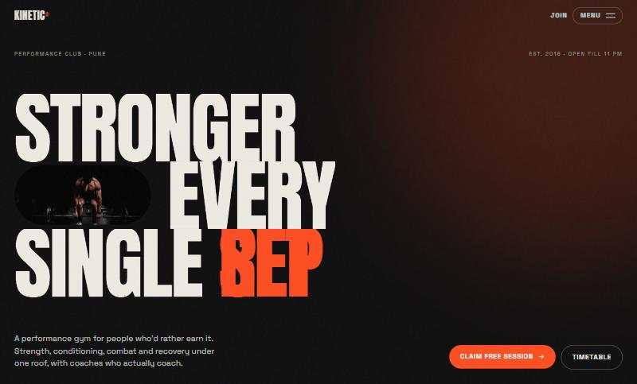
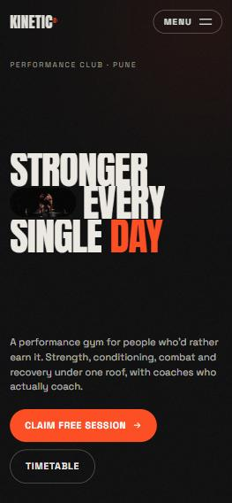
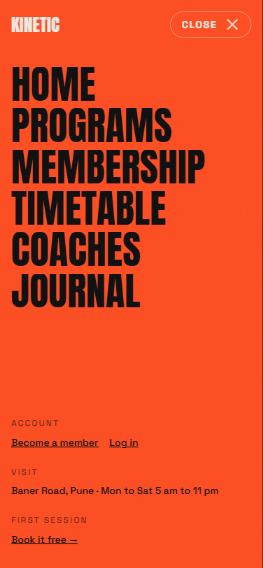
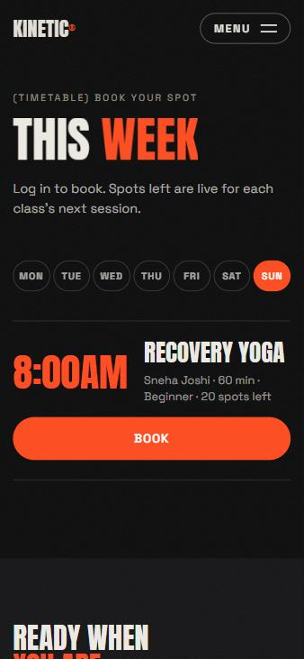
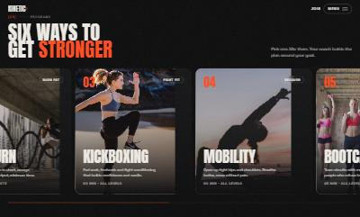
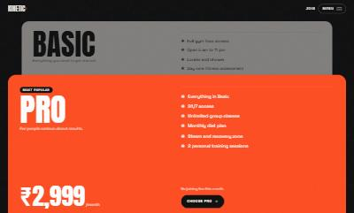
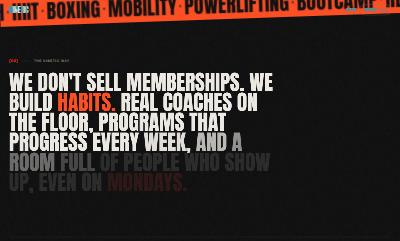
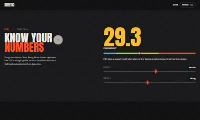

# KINETIC: performance gym website

A bold, animation-heavy gym website built for phones first, on a Laravel + MySQL backend. Visitors can book a free trial, join online, book classes and manage their bookings; staff use an admin panel.




## What makes the frontend different

Every animation is tied to scrolling, with a lighter version on phones and none for people who turn on "reduce motion".

| Effect | How it works |
| --- | --- |
| Intro loader | GSAP timeline: 0-100 counter, letters slide in, orange curtain lifts away (once per visit) |
| Kinetic headline | Text split into letters that slide up, inline photo pill, rotating word (DAY / REP / SET / WEEK) |
| Expanding photo | `clip-path` animated by scroll position; the section pins on desktop |
| Manifesto | Words light up one by one as you scroll (GSAP ScrollTrigger scrub) |
| Programs | Desktop: pinned section scrolls sideways with parallax images and a progress bar. Phones: native swipe with snap points |
| Membership | Cards stack with CSS `position: sticky`; each one shrinks and dims as the next slides over it |
| Coaches | Desktop: the coach's photo follows the mouse. Phones: thumbnails in each row |
| BMI calculator | Range sliders with live results (easier than typing on a phone) |
| Extras | Lenis smooth scrolling, magnetic buttons, custom cursor (mouse only), film-grain overlay, full-screen circular-reveal menu |

| Phone hero | Phone menu | Phone timetable |
| --- | --- | --- |
|  |  |  |

| Programs (pinned sideways scroll) | Stacking plan cards |
| --- | --- |
|  |  |
| **Scroll-lit manifesto** | **Live BMI sliders** |
|  |  |

## Tech stack

| Layer | Tools |
| --- | --- |
| Frontend | React 18, React Router, **Tailwind CSS 4**, **GSAP 3 + ScrollTrigger**, **Lenis**, Vite |
| Backend | PHP 8.2+, Laravel 12, Sanctum token login, Eloquent ORM, Form Request validation, rate limiting |
| Database | MySQL 8 / MariaDB (SQLite in-memory for tests) |
| Admin panel | Laravel Blade, Bootstrap 5, jQuery |
| CMS | WordPress (headless) via its REST API |
| Quality | 20 PHPUnit tests, Laravel Pint, GitHub Actions CI |
| DevOps | Docker Compose, Render blueprint, Vercel config |

## Run locally

**Backend** (needs PHP 8.2+, Composer, MySQL):

```bash
cd backend
composer install
cp .env.example .env && php artisan key:generate
php artisan migrate --seed
php artisan admin:create owner@example.com --name="Gym Owner"
php artisan serve
```

**Frontend:**

```bash
cd client
npm install
cp .env.example .env.local
npm run dev
```

Website: http://localhost:5174 · Admin: http://localhost:8000/admin · API docs: http://localhost:8000/docs

## Project structure

```
client/src/
  sections/      Home page sections (Hero, Story, Programs, Plans, Coaches, Extras)
  components/    Nav (full-screen menu), Footer, Preloader, Cursor, shared UI (Split text, Marquee, Magnetic)
  pages/         Home, Schedule, Join/Login, Dashboard, Blog
  lib/motion.js  GSAP + Lenis setup and a useGsap() hook that cleans up animations
backend/         Laravel 12 API + admin panel (same API as the IronPeak project)
```

## Related

Same backend, first frontend (React + Bootstrap): [ironpeak-gym-management-system](https://github.com/NovasHorizon/ironpeak-gym-management-system)

Photos from [Unsplash](https://unsplash.com). Kinetic is a fictional gym. Built by [Varadraj Khorate](https://github.com/NovasHorizon) with AI-assisted development.
